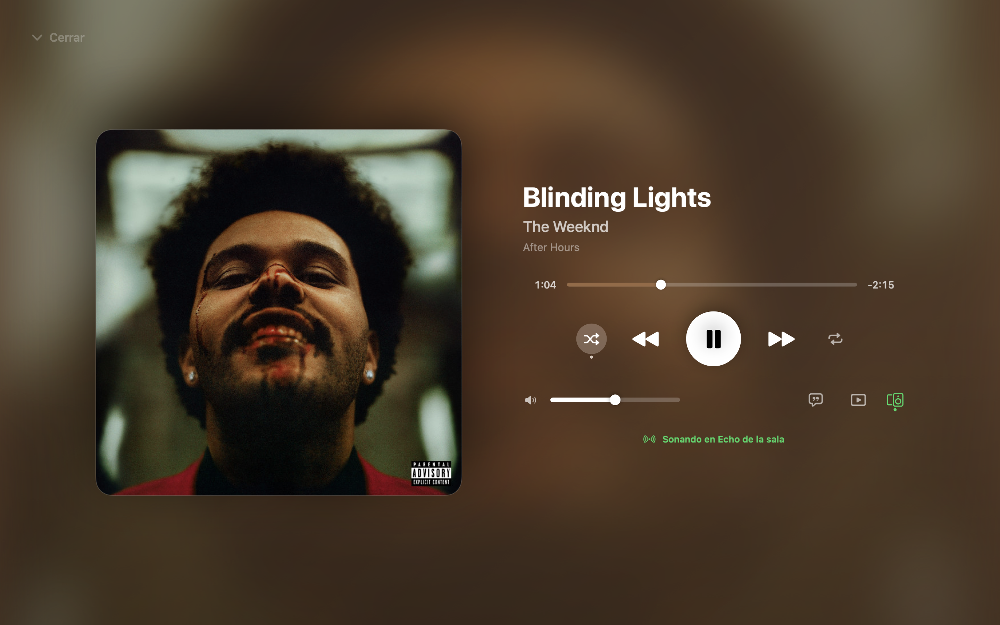
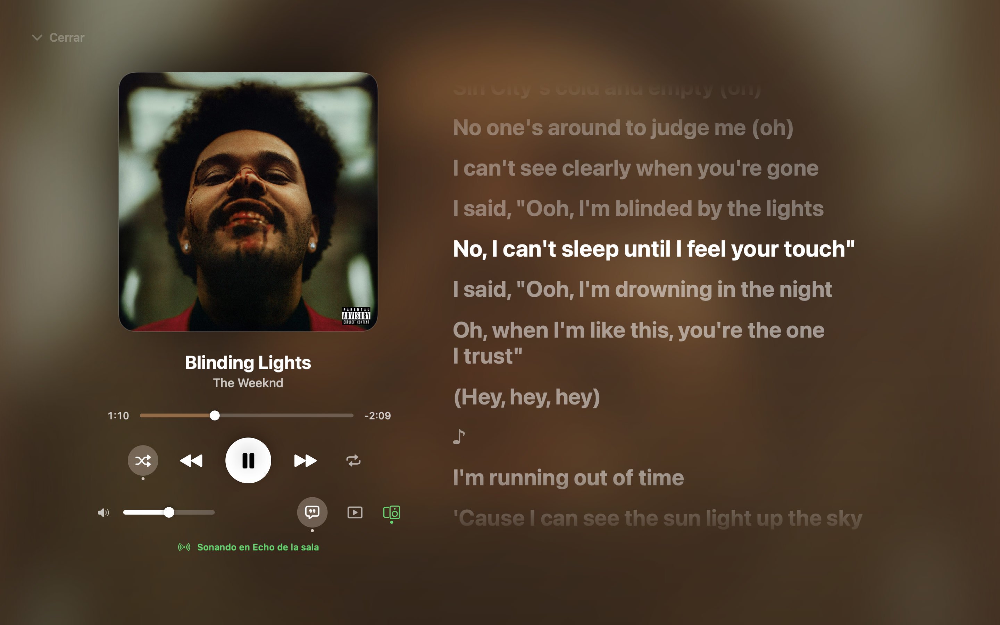

<div align="center">

# SpotifyMac

**Cliente nativo de Spotify para Windows y macOS — 100% Rust + Slint + librespot.**  
Sin Electron, sin navegador embebido y con controles nativos del sistema.

[](https://github.com/Jeztorres/Spotify/actions/workflows/release.yml)


</div>

---

## Descarga directa por plataforma

Elige tu sistema operativo para descargar el instalador más reciente desde [GitHub Releases](https://github.com/Jeztorres/Spotify/releases/latest):

| Plataforma | Descarga directa | Notas |
| :--- | :--- | :--- |
| **macOS** *(Apple Silicon / Intel)* | [**Descargar `SpotifyMac-macOS.dmg`**](https://github.com/Jeztorres/Spotify/releases/latest/download/SpotifyMac-macOS.dmg) | Abre el `.dmg` y arrastra `SpotifyMac.app` a **Aplicaciones**. |
| **Windows** *(64-bit, paquete completo)* | [**Descargar `SpotifyMac-Windows.zip`**](https://github.com/Jeztorres/Spotify/releases/latest/download/SpotifyMac-Windows.zip) | Incluye `spotify-win.exe` y `media/ffmpeg.exe` (portadas animadas). Descomprime y abre `spotify-win.exe`. |
| **Windows** *(solo ejecutable)* | [**Descargar `spotify-win.exe`**](https://github.com/Jeztorres/Spotify/releases/latest/download/spotify-win.exe) | Autónomo: el motor de reproducción viene incrustado. Puedes moverlo a cualquier carpeta o crear un acceso directo. |

> Si acabas de hacer `push`, espera ~5 minutos a que termine el workflow [**Release (Windows & macOS)**](https://github.com/Jeztorres/Spotify/actions/workflows/release.yml) para que los enlaces directos queden activos.

---

## Capturas

<p align="center">
  
  
</p>

---

## Características

- **100% Rust:** Interfaz fluida acelerada por GPU con **Slint** (`femtovg` + respaldo software) y motor de reproducción en **librespot**.
- **Integración nativa:**
  - **Windows:** Credenciales en el Administrador de credenciales de Windows, controles SMTC / teclas multimedia y bandeja del sistema.
  - **macOS:** Credenciales en el Llavero (*Keychain*), tipografía `SF Pro` y controles multimedia nativos (`souvlaki`).
- **Portadas animadas y letras:** Soporte para letras sincronizadas, traducción y fondos animados HLS (con `ffmpeg` opcional).

---

## Arquitectura del proyecto

```text
spotify_repo/
├── core/      # spotify-core: modelos, cola, ranking de búsqueda, colores y protocolos
├── app/       # spotify-win: UI en Slint, caché de portadas, letras, keyring y controles multimedia
├── Engine/    # spotifymac-engine: motor librespot + lecturas de sesión (JSON vía stdin/stdout)
└── .github/   # CI/CD para compilar automáticamente Windows (.zip/.exe) y macOS (.dmg)
```

---

## Compilación manual

### Requisitos
- [Rust](https://rustup.rs/) (`cargo` y `rustc` estables)
- *(Opcional)* `ffmpeg` para portadas animadas HLS (`brew install ffmpeg` en macOS)

### Windows
```powershell
cd Engine
cargo build --release
cd ..
cargo build --release -p spotify-win
```

### macOS
```bash
cd Engine && cargo build --release && cd ..
cargo build --release -p spotify-win
```

### Pruebas
```bash
cargo test --workspace
```
